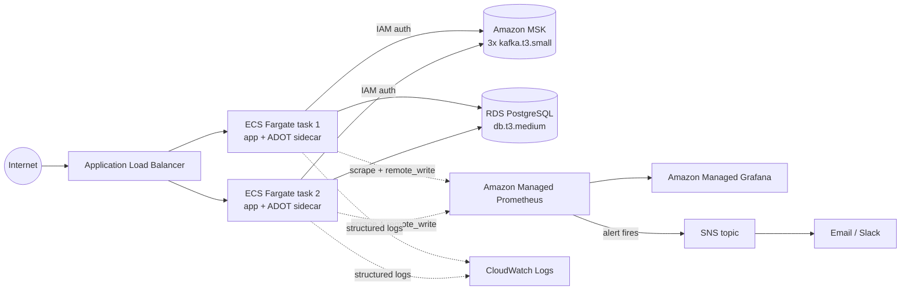

# AWS Infrastructure Proposal — case_intelbras_kafka_java (backend only)

This is a proposal, not a deployment. Nothing in `terraform/` has been applied —
these numbers describe what *would* be provisioned and what it would cost, so the
decisions can be reviewed before any AWS resource is created. All prices are
**us-east-1, on-demand list price, no committed-use discounts, approximate** —
gathered from AWS pricing pages and third-party trackers in October 2026, not from
AWS's own pricing API. Re-verify in the [AWS Pricing Calculator](https://calculator.aws/)
before treating any number here as a budget commitment.

Frontend, CI/CD pipeline, and multi-region/DR are explicitly out of scope — this
covers the backend only, matching `case_intelbras_kafka_java`.

## 1. What we're proposing

| Concern | AWS service | Why this, not an alternative |
|---|---|---|
| Kafka | **Amazon MSK** (provisioned, 3× `kafka.t3.small`, IAM auth) | Directly replaces the local single-broker KRaft setup with the real managed equivalent of what the app already talks to (`spring-kafka`, 4 topics, 3 partitions/topic). MSK Serverless was considered — rejected because its per-partition/throughput pricing model obscures the partition-count-vs-cost story this proposal is built to show (see §4); provisioned MSK makes "add a broker, get more throughput" a direct, visible line item. |
| App compute | **ECS on Fargate**, 2 tasks baseline, behind an **ALB** | No EC2 fleet to patch/size for a single stateless Spring Boot service; Fargate's per-task billing matches the "cost per unit of capacity" framing this proposal needs. EKS was considered and rejected as unjustified operational overhead for one service. |
| Audit store | **RDS for PostgreSQL**, `db.t3.medium`, single-AZ baseline | Same engine the app already targets (`application.yml`, Flyway migrations) — zero schema/driver changes. Aurora PostgreSQL was considered as a scaling path (§5), not the baseline, since its per-vCPU pricing floor is higher than this workload's baseline load justifies. |
| Topic ownership | **The app itself** (unchanged) | `KafkaTopicConfig`'s existing `@Bean NewTopic` definitions keep creating topics on startup via `KafkaAdmin`, exactly as they do against local Kafka today. Terraform provisions the MSK *cluster* only — one source of truth for topic config, not two. |
| Container registry | **ECR** | Standard pairing with ECS/Fargate; image scanning on push. |
| Secrets | **Secrets Manager** | RDS master credentials generated and injected into the ECS task definition as `secrets`, never as plain environment variables or in Terraform state in the clear beyond what Secrets Manager itself encrypts. |
| Metrics + alerts | **Amazon Managed Prometheus (AMP)** + an **ADOT Collector sidecar** per task | Scrapes the same `/actuator/prometheus` endpoint the local Prometheus already scrapes — **zero application code changes**. The 5 alert rules in `observability/alerts.yml` port over with the same expressions (see `terraform/observability.tf`), routed through AMP's Alertmanager to SNS. |
| Dashboards | **Amazon Managed Grafana (AMG)** | Same role the local Grafana container plays; the existing `device-events-dashboard.json` panels import directly, since they query the same metric names. |
| Logs | **CloudWatch Logs** (`awslogs` driver on the ECS task) | The app already emits one structured JSON `ExecutionLog` line per behaviour to stdout — CloudWatch Logs ingests that as-is. CloudWatch Logs Insights replaces `docker compose logs | grep`. |
| Notifications | **SNS** (email baseline) | Cheapest, fewest moving parts; Slack/PagerDuty integration is a receiver swap, not a redesign. |

**Explicitly deferred from the baseline** (cheap to add later, not needed to prove the
architecture): HTTPS/ACM certificate on the ALB, a second NAT Gateway per AZ, a 3rd
availability zone, RDS read replicas, WAF. Each is called out inline in the Terraform
where it would attach.

## 2. Architecture

Everything except the ALB sits in private subnets, reachable only from the ECS
tasks' security group (see `terraform/security_groups.tf`). Full resource list in
`terraform/`.

## 3. Monthly cost — baseline tier

All us-east-1, on-demand, ~730 hours/month, before any committed-use discount:

| Resource | Sizing | Est. monthly cost |
|---|---|---|
| MSK brokers | 3× `kafka.t3.small` @ ~$0.0456/hr | ~$100 |
| MSK storage | 3× 100 GB @ ~$0.10/GB-month | ~$30 |
| ECS Fargate | 2 tasks × 1 vCPU/2 GB @ ~$0.0405/vCPU-hr + $0.0044/GB-hr | ~$72 |
| ALB | base + ~1–2 LCU at low baseline traffic | ~$25 |
| NAT Gateway | 1× @ $0.045/hr + modest data processing | ~$33 |
| RDS | `db.t3.medium` single-AZ @ ~$0.072/hr + 50 GB gp3 | ~$59 |
| Amazon Managed Prometheus | ingestion + storage at this metric volume | ~$5 |
| Amazon Managed Grafana | 1 Admin seat @ $9/user | ~$9 |
| CloudWatch Logs | ingestion + storage at this log volume | ~$3 |
| ECR, Secrets Manager, SNS, data transfer | | ~$5 |
| **Total** | | **≈ $340/month** |

This is a **starting estimate for sizing conversations, not a quote** — it does not
include taxes, Savings Plans, the AWS free tier (which would reduce the real first-year
bill), or non-default options like Multi-AZ RDS or a second NAT Gateway.

## 4. Capacity at this cost

The bottleneck in this architecture is **not Kafka throughput** — Kafka comfortably
moves far more raw bytes/sec than this workload produces. It's the audit path's
one-DB-round-trip-per-event design (`existsByDedupKey` + `INSERT`, see
`case_intelbras_kafka_java/ARCHITECTURE.md` → *Idempotency at scale*), same conclusion
that document already reached for the local setup, now mapped onto real instance
sizes.

With 3 partitions/topic × 4 topics = **12 consumer threads** available (matching MSK's
partition count, same as local), and that document's own estimate of **~50–100
events/sec per consumer thread** (one DB round trip each), the theoretical consumer-side
ceiling is 600–1,200 events/sec — but a single `db.t3.medium` (2 burstable vCPUs) won't
sustain that; its CPU credit balance and connection ceiling cap it well below the
consumer threads' combined theoretical throughput.

**Working estimate for the baseline tier: ~150–400 events/sec sustained**, i.e.:

| Window | Events |
|---|---|
| Per minute | ~9,000–24,000 |
| Per day | ~13M–35M |
| Per month | ~390M–1.05B |

This comfortably clears the case brief's "millions of events/day" framing — but **this
range is a reasoned estimate, not a load test result.** The one tool that can turn it
into a real number already exists in this project: deploy this infrastructure, then
point `case_intelbras_kafka_java`'s own `POST /events/random-stream/start` at it and
ramp `eventsPerMinute` while watching `AuditConsumerLagHigh` in Grafana — exactly the
tool that endpoint was built for (see that project's `ARCHITECTURE.md` → *Load
generation: random event stream*). Treat the table above as where to start that test,
not as a number to build a capacity plan on unverified.

## 5. Scaling proposal

Every lever below is a Terraform variable change plus `terraform apply` — no
architectural redesign. Ordered cheapest/fastest first.

| Lever | Change | Speed | Est. new monthly cost | Capacity effect |
|---|---|---|---|---|
| **Free**: DB upsert | Replace `existsByDedupKey` + `INSERT` with `INSERT ... ON CONFLICT DO NOTHING` (already flagged as the production fix in `ARCHITECTURE.md`) | 1 PR, 1 deploy | **$0** | ~2× per-connection throughput — do this before spending on hardware |
| ECS task count | `ecs_desired_count` 2 → 6 (already wired to autoscale on CPU, `terraform/ecs.tf`) | Minutes, zero downtime | +~$144/month at 6 tasks | Scales compute/log-emission headroom linearly; doesn't move the RDS ceiling alone |
| RDS vertical | `db.t3.medium` → `db.m5.large` (2 → 2 vCPU but non-burstable, 8 GB RAM) | ~5–10 min (brief failover if Multi-AZ, more if single-AZ) | ~$180/month (RDS line only, up from ~$59) | Removes the CPU-credit ceiling; realistic 3–5× sustained throughput over `db.t3.medium` |
| RDS Multi-AZ | `rds_multi_az = true` | Minutes, one failover during cutover | ~2× the RDS line (~$118/month) | No capacity change — this is the availability upgrade, not a throughput one |
| MSK broker type | `kafka.t3.small` → `kafka.m5.large` (3 brokers) | Rolling update, minutes per broker, no downtime | ~$460/month broker compute (up from ~$100) | Headroom for higher per-partition throughput and more concurrent consumer groups; not the binding constraint until the DB tier above is also upgraded |
| Partition count | Increase partitions per topic (Kafka supports this **online, without recreating the topic** — only *decreasing* needs recreation) + raise `concurrency` on the `@KafkaListener`s to match | Minutes (online), but each new partition needs its own DB-round-trip budget to be worth anything | $0 extra (same brokers, until broker capacity is the limit) | Raises the consumer-thread ceiling; only pays off after the DB tier is upgraded too — partitions without DB headroom just mean more idle-waiting threads |
| Second NAT Gateway + 3rd AZ | `availability_zones` += 1, one NAT per AZ | Minutes | +~$33–66/month | Availability, not throughput — removes single-NAT/2-AZ as a blast radius |

**A realistic "scale for a real production launch" package** — `db.m5.large` RDS +
Multi-AZ + 3× `kafka.m5.large` + 6 ECS tasks + 3 AZs — lands around **$950–1,050/month**
and should sustain roughly **1,000–2,500 events/sec** (again: estimate, validate with
the random-stream load generator), i.e. low-to-mid **billions of events/month**. That's
a ~3× cost increase over baseline for a ~5–8× capacity increase, because the baseline's
`db.t3.medium` burstable-CPU ceiling — not raw service pricing — is what's
disproportionately expensive to outgrow.

**How fast can we actually react to a traffic spike?** ECS autoscaling reacts in
minutes automatically (already configured, `terraform/ecs.tf`). Everything else above
is a deliberate `terraform apply`, not an automatic response — reasonable, since Kafka
broker and RDS instance changes are not things to automate blindly on a metric
threshold. The realistic playbook for a sustained, known traffic increase: apply the
DB upsert fix first (free, immediate), let ECS autoscaling absorb the next layer
automatically, and only reach for RDS/MSK vertical scaling once Grafana shows the DB or
broker tier is the actual constraint — not before.

## 6. What this proposal deliberately does not solve

- **CI/CD**: no pipeline to build/push the image or run `terraform plan` in automation —
  out of scope for a backend-only infra proposal.
- **Multi-region / DR**: single-region by design; a real DR story is a separate proposal.
- **TLS on the ALB**: omitted from the baseline to keep scope to the app itself; it's a
  second listener + an ACM certificate + a Route 53 record, not a redesign.
- **Fine-grained Kafka ACLs**: the baseline's IAM policy gives the task role broad
  topic/group access scoped to this one cluster; per-topic ACLs are a hardening step,
  not a capacity one.
